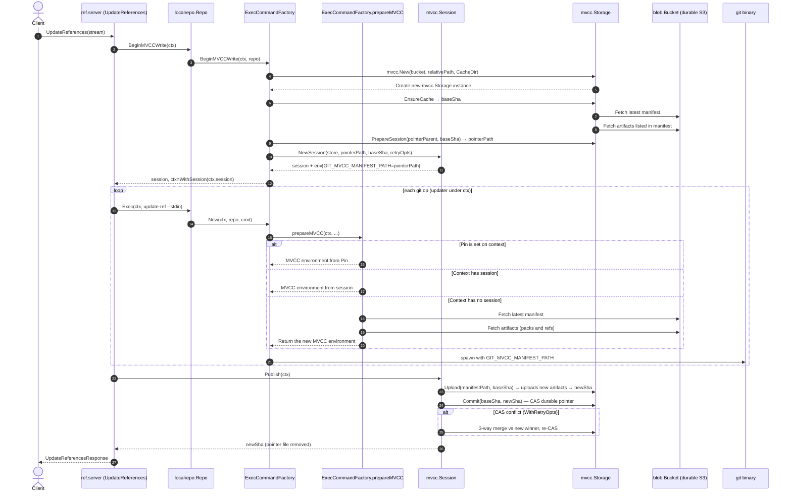
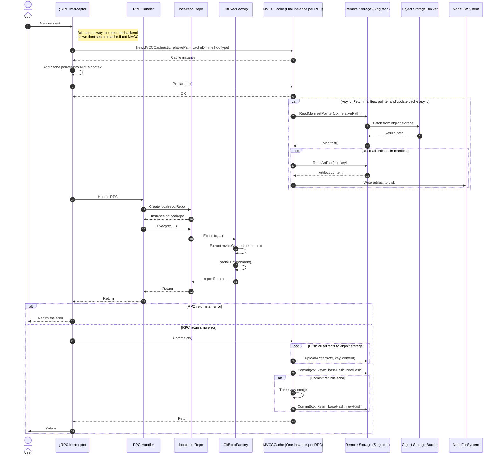

# MVCC Gitaly RPC flow

This document serves two purposes.

One, it serves as a documentation of the current flow of a request in Gitaly (on the POC branch) when using
the MVCC backend. This is useful for anyone working on implementing the MVCC "write" and "read" path of a
request in Gitaly, to make sure everyone working on this works with the same mental model

Secondly, it serves as a starting point for a discussion about how we feel about this design, and improvements
that could be made.

The document is a description of the "write" path of a request. This description is taken from the POC branch
at the time of writing. All code snippets are actual code snippets.

For the "read" path, as far as I know, the path is the same except steps 22 to 26 are not executed.

The second part of the document is a list of change proposal for this design.

## Write path of a request

Here is the **write** path for a RPC targeting a repository using the MVCC backend. This diagram uses
the `UpdateReferences` RPC as an example.

The operations are as follow:

### 1. Request coming from a client

Nothing more to say here.

### 2. UpdateReferences handler

In the handler, a `localrepo.Repo{}` instance is created. The `localrepo.Repo{}` has a new method
called `BeginMVCCWrite`. This method is called in the handler. Every handler that creates a `localrepo.Repo{}`
would call this method.

Example:

```go
session, ctx, err := repo.BeginMVCCWrite(ctx)
if err != nil {
        return fmt.Errorf("beginning mvcc write: %w", err)
}
if session != nil {
        defer session.Discard()
}
```

The method returns a `mvcc.Session{}`, which contains a reference to the MVCC manifest. This is to
ensure that every Git commands spawned during the lifetime of this RPC uses the same manifest hash,
otherwise Git commands for the same RPCs might execute on different "snapshot" of the Git repository,
which can lead to data corruption.

The method also returns a context, which contains the `mvcc.Session`. This context must be carried in
all `git` commands in order for the session to be used.

At the end of the RPC, when everything succeeded, the resulting MVCC artifacts (ie: this is a WRITE
call) and the manifest pointer are pushed to S3 by calling:

```go
if session != nil {
        if _, err := session.Publish(ctx); err != nil {
               return mvcc.MapPublishError(err)
        }
}
```

### 3. BeginMVCCWrite on the ExecCommandFactory

Under the hood, when `repo.BeginMVCCWrite(ctx)` is called on the `localrepo.Repo{}` this method defers
to a method of the same name on the `ExecCommandFactory`.

```go
func (repo *Repo) BeginMVCCWrite(ctx context.Context) (*mvcc.Session, context.Context, error) {
        session, err := repo.gitCmdFactory.BeginMVCCWrite(ctx, repo)  // repo.gitCmdFactory is the ExecCommandFactory
        if err != nil {
               return nil, ctx, err
        }
        if session == nil {
               return nil, ctx, nil
        }
        return session, mvcc.WithSession(ctx, session), nil
}
```

The `ExecCommandFactory` contains a reference to the object storage bucket that holds the Git data
(source of truth).

### 4 (and 5). Create a `mvcc.Storage`

The `ExecCommandFactory` create a new instance of `mvcc.Storage`, which holds the logic to call S3
and sync the local cache.

This is done as:

```go
store := mvcc.New(cf.bucket, repo.GetRelativePath(), cacheDir)
```

All interactions between the local `mvcc` cache of a repository and S3 is contained in the `mvcc.Storage{}`
struct.

### 6. Updates the local mvcc cache

This is done by calling `mvcc.Storage{}.EnsureCache`. It will call S3 to fetch the latest manifest
manifest, and sync the local cache to make sure it has all the required artifacts to operate with this
manifest version.

### 7 (and 8). Fetch from S3

The `mvcc.Storage` fetches the latest manifest from S3 and all listed artifacts that are missing
(packs and refs)

### 9. Prepare the MVCC session on disk

`mvcc.Storage{}.PrepareSession` allocates a fresh manifest pointer file on disk. This is the manifest's
path that will be set in `GIT_MVCC_MANIFEST_PATH`.

### 10 (and 11 and 12). Create the MVCC session

An `mvcc.Session{}` looks like:

```go
type Session struct {
        storage      *Storage
        manifestPath string
        baseSha      string
        retryOpts *RetryOpts
        mu       sync.Mutex
        uploaded string
        done     bool
}
```

It holds a pointer to the `mvcc.Storage`, a path to the manifest to be used for all Git operation during
that session (ie: an RPC) and the `baseSHA`. This session is returned to the RPC handler (in our
case `UpdateReferences`)

### 13 (and 14). Executing a Git command

Now that the MVCC cache has been hydrated and the manifest has been set in the `mvcc.Session`, everything
is ready to call Git commands.

To execute a Git command, one must use the option `gitcmd.WithMVCCWrite(&mvccSession)` with a pointer
to an `mvcc.Session`, and call `localrepo.Repo{}.Exec`, which under the hood will defer to the
`ExecCommandFactory`.

```go
var mvccSession *mvcc.Session
cmd, err := repo.Exec(ctx,
        gitcmd.Command{
               Name:  "update-ref",
               Flags: cmdFlags,
        },
        txOption,
        gitcmd.WithSetupStdin(),
        gitcmd.WithSetupStdout(),
        gitcmd.WithStderr(&stderr),
        gitcmd.WithMVCCWrite(&mvccSession),
)
```

### 15 (and 16 to 20). prepareMVCC

As part of the usual business logic to create the `git` command, there is now an additional step, which
is to prepare the MVCC environment for the command.

Here is the code:

```go
if cf.cfg.Git.S3BackendEnabled && repo != nil {
        mvccEnv, _, err := cf.prepareMVCC(ctx, repo, repoPath, config.mvccSessionOut)
        if err != nil {
               return nil, fmt.Errorf("mvcc prepare: %w", err)
        }
        env = append(env, mvccEnv...)
}
```

This code above sets the necessary environment variables for MVCC and adds them to the Git command config.

Notice the `config.mvccSessionOut` parameter? This is the pointer to the MVCC Session passed above
with `gitcmd.WithMVCCWrite(&mvccSession)`. In fact, `config.mvccSessionOut` is a `mvcc.Session`, to
allow the `ExecCommandFactory` to set the pointer to a new instance of `mvcc.Session`. More in this
down below.

As part of the `prepareMVCC()` method, a couple things happens.

First, if the context has a `Pin{}` set, we use the manifest from the pin. This happens when the RPC
is coming from a Gitaly hooks, for example. This is to ensure the RPC executes against the same manifest
hash as the original RPC.

```go
if pin, ok := mvcc.PinFromContext(ctx); ok {
        // skipping stuff here for clarity ...
        if pin.Manifest != "" {
               env = append(env, "GIT_MVCC_MANIFEST="+pin.Manifest)
        }
        if pin.ManifestPath != "" {
               env = append(env, "GIT_MVCC_MANIFEST_PATH="+pin.ManifestPath)
        }
        return env, nil, nil
}
```

Then, checks if there is a session in the context.

```go
if outerSession, ok := mvcc.SessionFromContext(ctx); ok {
        return []string{"GIT_MVCC_MANIFEST_PATH=" + outerSession.ManifestPath()}, nil, nil
}
```

In our case, there is one, which was set at step 2.

If there is no session in the context, then a new `mvcc.Storage` is created and the repository cache is
hydrated using the latest manifest from S3.

The call to `mvcc.CacheReadyFromContext(ctx)` seems to be only used during the tests.

```go
store := mvcc.New(cf.bucket, repo.GetRelativePath(), cacheDir)

// If the interceptor kicked off a background fetch for this RPC,
// a CacheReady semaphore is present on the context. Wait for it
// to complete — this is our synchronization point ensuring all
// manifest artifacts exist on disk before Git starts. If the RPC
// context expires before the fetch completes we report Aborted so
// the client can retry.
var baseSha string
if cr := mvcc.CacheReadyFromContext(ctx); cr != nil {
        sha, err := cr.Wait(ctx)
        if err != nil {
               return nil, nil, structerr.NewAborted("mvcc: cache not ready for %s: %w", repo.GetRelativePath(), err)
        }
        baseSha = sha
} else {
        // Fallback: no interceptor ran (e.g. pin-cleared path, or the
        // interceptor couldn't resolve the repo). Hydrate inline.
        sha, err := store.EnsureCache(ctx)
        if err != nil {
               return nil, nil, fmt.Errorf("hydrate cache: %w", err)
        }
        baseSha = sha
}
```

Then, after all this, it checks if the `mvcc.Session` passed by `gitcmd.WithMVCCWrite(&mvccSession)` is
`nil`, and if so returns the `baseSHA` from the newly refreshed cache using the new store.

This part is complex, and there is likely a better way to handle all edge cases. This is probably a result of
the vibe coding.

```go
if writeSessionOut == nil {
        // Read path: pin the spawned git to the prefetched snapshot.
        return []string{"GIT_MVCC_MANIFEST=" + baseSha}, nil, nil

}
```

If the `mvcc.Session` passed by `gitcmd.WithMVCCWrite(&mvccSession)` is not `nil`, then it seems it is
overwritten here:

```go
pointerParent := filepath.Join(repoPath, mvccPointerDirName)
pointerPath, _, err := store.PrepareSession(pointerParent, baseSha)
if err != nil {
        return nil, nil, fmt.Errorf("prepare session: %w", err)
}

session := mvcc.NewSession(store, pointerPath, baseSha, cf.mvccSessionOpts()...)
*writeSessionOut = session

return []string{"GIT_MVCC_MANIFEST_PATH=" + pointerPath}, nil, nil
```

Much of this code was written as a POC, and is detailed here to document the current logic.

### 21. Execute the Git command

At that point the environment has been prepared, and the Git command can be called with the proper
MVCC environment variables

### 22 (and 23 to 26). Publish the new state

Once all Git commands of the RPC have succeeded, the new state must be published to object storage.

First, all artifacts are uploaded to S3. This is fine because new artifacts are just not referenced by
the manifest pointer at this point, so there is no harm in uploading artifacts at this point.

The manifest is also uploaded. This is also fine, because as long as the manifest pointer does
not point to this manifest, it is harmless.

Then, a first attempt is made to advance the manifest pointer by doing a "Compare And Swap (CAS)" with
the manifest that was uploaded previously. If it succeeds, then we return from the RPC handler.

If the CAS fails, then a three-way merge is attempted to try and resolve conflict.

If it still fails, an error is returned to the client.

It is worth noting that uploaded artifacts that ends up not being referenced (ex: result of a
failed transaction) will eventually get pruned away.

### 27. Return from the handler

Return the response to the client



## Change proposals

What follows propose a new request flow, that exhibits the following properties:

- Does not require changes (or very minimal changes) to the current RPC handlers.
- Split the responsibility of communication with cloud storage and the local repository
  cache into two distinct components.

Here are a list of components, and their definition, used in the proposed flow.

```go
// RemoteStorage is the interface used for a component to communicate with
// object storage. An instance of RemoteStorage should be a shared instance
// (singleton) used by all instances of `Cache` (see below).
// To allow for the migration, we can have multiple implementations.
type RemoteStorage interface{
  ReadManifestPointer(context.Context, key string) ([]byte, error)
  ReadArtifact(context.Context, key string) ([]byte, error)
  PutArtifact(context.Context, key string, content []byte) error
  Commit(ctx, key string, baseHash string, newHash string) error
}
```

```go
// S3BucketStorage is an implementation of RemoteStorage
type S3BucketStorage struct{
  bucket *blob.Bucket
  prefix string
}
```

```go
// Cache is the interface that contains all required method to interact
// with the mvcc cache of a repository. The scope of an instance of Cache
// is the lifetime of an RPC. An instance of Cache is created once at the
// start of the RPC, and garbage collected at the end of the RPC.
type Cache interface{
  // Prepare prepares the local MVCC cache so that Git operations can
  // be performed on the repository. Under the hood, it should call
  // the shared RemoteStorage instance, fetch the manifest pointer, and
  // make sure all required artifacts are in the mvcc cache.
  // This is an async call, it should not wait for the cache to be ready
  // before returning.
  Prepare(ctx) error

  // PrepareWithManifest is used when the RPC already contains a manifest hash
  // in the metadata. Example: request coming from Gitaly hooks.
  // Instead of using the latest manifest pointer, it will prepare the
  // cache to use this manifest hash and use it for the duration of the RPC.
  PrepareWithManifest(hash string) error

  // WaitUntilReady is a blocking call, and should unblock when the mvcc cache
  // is ready. This is useful to start the process of updating the cache
  // ahead of time, in parallel with other things, so that once the handler
  // is ready to execute Git commands, the cache has already started warming up.
  WaitUntilReady(ctx) error

  // Commit commits the result of the RPC (only Mutator RPC).
  Commit(ctx) error

  // Environment returns the list of environment variable to use
  // when invoking Git.
  // Ex:
  // - `GIT_MVCC_MANIFEST`
  // - `GIT_MVCC_MANIFEST_PATH`
  Environment() []string
}
```

```go
// MvccCache implements Cache interface.
type MvccCache struct{
  // rs is a reference to a shared instance of RemoteStorage which is
  // responsible to access artifacts+manifests in object storage
  rs RemoteStorage

  // relativePath is the relative path of the repository related to this Cache instance
  relativePath string

  // cacheDir is the directory of the mvcc cache for this repository
  cacheDir string

  // readOnly indicates if the RPC using this cache is a accessor or mutator RPC
  readOnly bool

  // manifest is a parsed copy of the manifest on which the current RPC operates on
  manifest mvcc.Manifest

  // ready unblocks when the cache is warmed and ready for Git command
  // to be executed against it.
  ready chan struct{}
}
```

And here is a sequence diagram of a flow that would use those components to handle an RPC.


