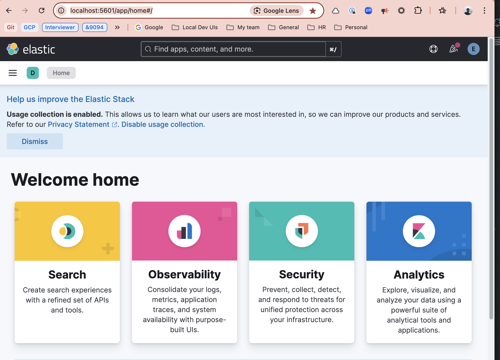
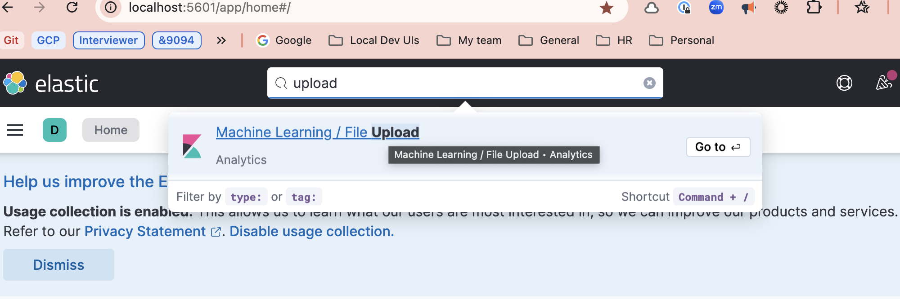
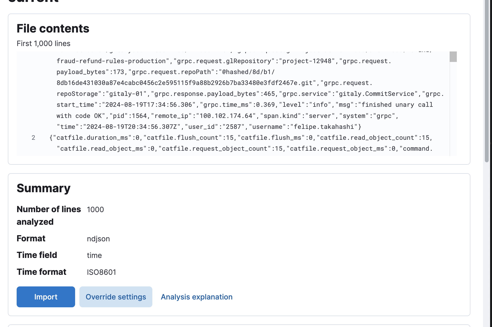
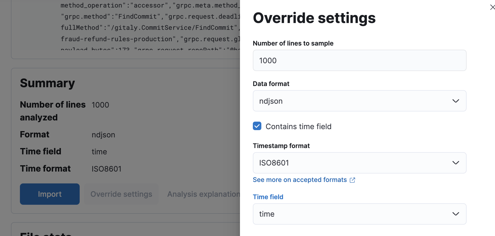
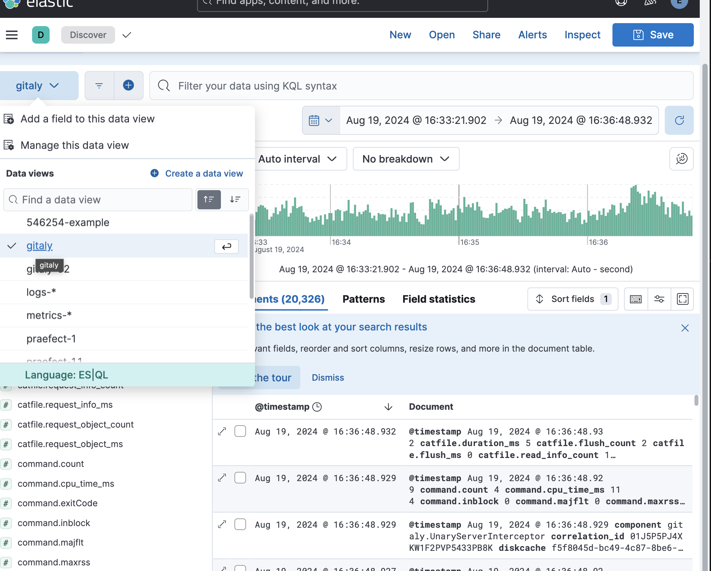

# Setting up a local ELK stack for downloaded logs

You can set up a local ELK and import log files into it. A local ELK stack lets you analyze a
customer's Gitaly logs with the same tooling used for [Kibana](https://log.gitlab.net).
Troubleshooting then works the same way for GitLab.com and GitLab Self-Managed.

## Start the stack

Requires Docker and Docker Compose.

1. Clone [`docker-elk`](https://github.com/deviantony/docker-elk).
1. Run `docker compose up setup` to create the prerequisites.
1. Run `docker compose up`. Kibana comes up at
   [localhost:5601](http://localhost:5601/app/home#/), with username `elastic` and password
   `changeme`.

   

## Import a log file

1. Get the Gitaly log out of the support package. After unzipping, it is at
   `<unzip dir>/var/log/gitlab/gitaly/current`.
1. In Kibana, search for `upload` to reach the file upload page.

   

1. Drag the log file onto the page. Any log file works, not only the Gitaly one.

   

1. Under 'Override settings', set the time field to `time` or `@timestamp`. Choosing anything else
   may lead to empty results.

   

1. Name the index after the ticket number, so several investigations can coexist.
1. Open 'Analytics > Discover' and select your index to read the logs.

   

The Gitaly log fields, and the correlation ID to filter on first, are described in
[Logging in Gitaly](logging.md).

## Further reading

- [Analyze large log files using ELK](https://ahmedmusaad.com/analyse-large-log-files-using-elk/)
- [`docker-elk`](https://github.com/deviantony/docker-elk)
