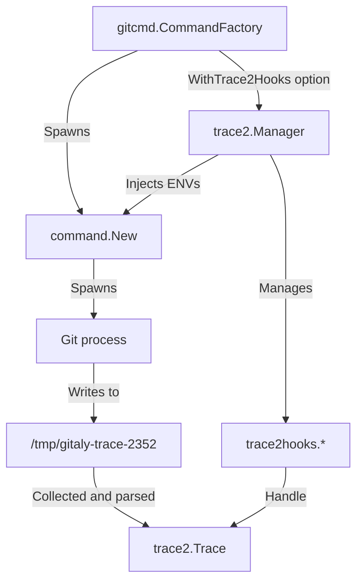
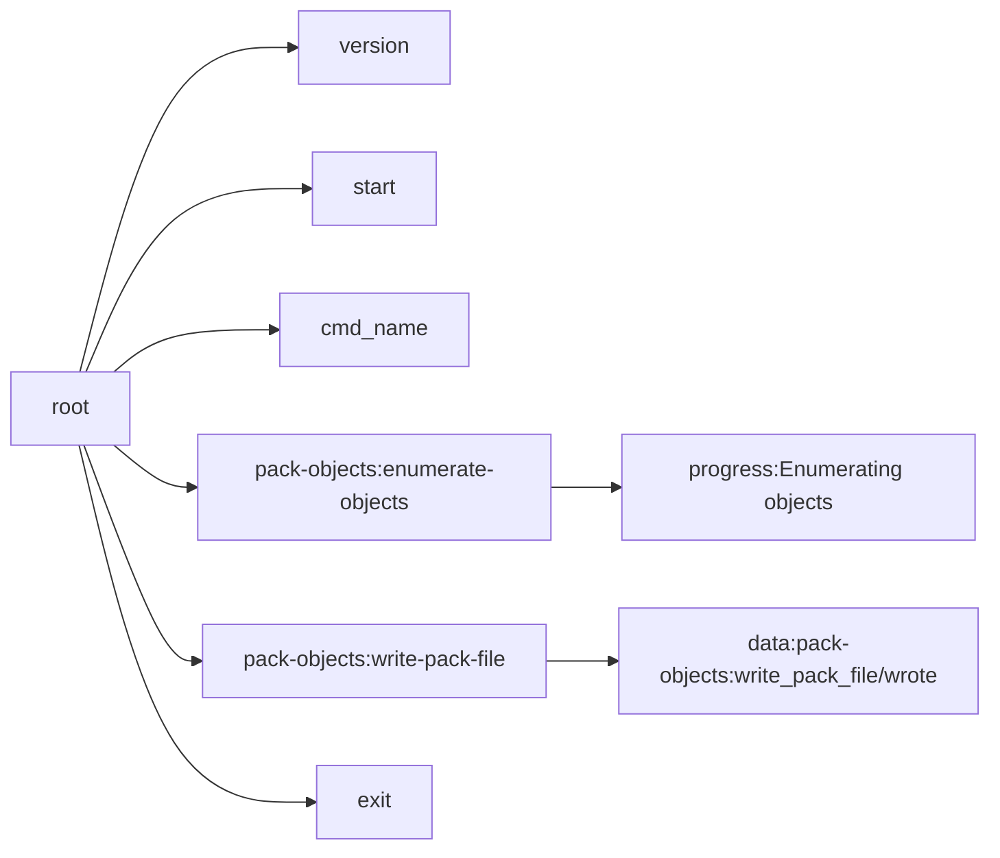

# Trace2 integration

Git includes a tool called [Trace2](https://git-scm.com/docs/api-trace2) that:

- Allows Git processes to display important underlying events and related
  measurements.
- Records child process activities.

However, enabling Trace2 may cause increased overhead for Git processes and could
potentially pose risks when transmitting events between Gitaly and Git processes.
Therefore, you should not enable Trace2 for all Git processes.

Gitaly offers the capability of Trace2 activation on a per subset basis for Git
commands through the use of a "hook" mechanism. This mechanism offers the
advantage of providing more precise monitoring, lowering the risk of potential
hazards previously associated with global Trace2 activation, and reducing
unnecessary overhead.

## How it fits together



Git writes its events to a temporary file. Gitaly reads that file when the command finishes, parses
it into a `trace2.Trace` tree, and passes the tree to each active hook.

Three environment variables turn the instrumentation on. Gitaly sets these in
[`internal/git/trace2`](../internal/git/trace2); it deliberately does not set the rest of the
`GIT_TRACE2*` family defined on the [documentation page](https://git-scm.com/docs/api-trace2).

| Variable                | Purpose                                                                      |
|:------------------------|:-----------------------------------------------------------------------------|
| `GIT_TRACE2_EVENT`      | Enables JSON event output, pointed at the temporary file                      |
| `GIT_TRACE2_PARENT_SID` | The process identifier prefix. Gitaly sets it to the request's correlation ID |
| `GIT_TRACE2_BRIEF`      | Drops redundant fields such as `file`, `line`, and absolute `time`            |

Because `GIT_TRACE2_PARENT_SID` carries the correlation ID, Trace2 output ties back to the request
that caused it. See [Logging in Gitaly](logging.md#correlation-ids).

## Which hooks run, and when

`DefaultTrace2HooksFor` in [`internal/git/gitcmd`](../internal/git/gitcmd) builds the hook list per
command. Every hook is conditional, so most commands get none:

| Hook                 | Runs when                                                                               |
|:---------------------|:----------------------------------------------------------------------------------------|
| `TracingExporter`    | The request is sampled for distributed tracing                                          |
| `PackObjectsMetrics` | The command is `pack-objects`                                                           |
| `ReceivePack`        | The command is `receive-pack`, with the `receive_pack_trace2_hook` feature flag enabled  |
| `LogExporter`        | The `log_git_traces` feature flag is enabled                                            |

The implementations are in [`internal/git/trace2hooks`](../internal/git/trace2hooks). `LogExporter`
writes the trace to the Gitaly log and is rate limited, because a trace per Git command is a lot of
log volume.

## The event stream and the tree

Trace2 emits a flat, chronological list of JSON events. Some events open a section:
`region_enter`, `cmd_start`, and `child_start`. A matching `region_leave` or `atexit` closes it. The
stream below comes from `git pack-objects`, trimmed:

```json
{"event":"version","thread":"main","time":"2023-02-22T12:05:04.840009Z","evt":"3","exe":"2.39.1"}
{"event":"start","thread":"main","t_abs":0.002338,"argv":["git","pack-objects","toon","--compression=0"]}
{"event":"cmd_name","thread":"main","name":"pack-objects","hierarchy":"pack-objects"}
{"event":"region_enter","thread":"main","repo":1,"nesting":1,"category":"pack-objects","label":"enumerate-objects"}
{"event":"region_enter","thread":"main","repo":1,"nesting":2,"category":"progress","label":"Enumerating objects"}
{"event":"region_leave","thread":"main","repo":1,"t_rel":0.001083,"nesting":2,"category":"progress","label":"Enumerating objects"}
{"event":"region_leave","thread":"main","repo":1,"t_rel":0.001435,"nesting":1,"category":"pack-objects","label":"enumerate-objects"}
{"event":"region_enter","thread":"main","repo":1,"nesting":1,"category":"pack-objects","label":"write-pack-file"}
{"event":"data","thread":"main","repo":1,"t_abs":0.008451,"t_rel":0.003996,"nesting":2,"category":"pack-objects","key":"write_pack_file/wrote","value":"1"}
{"event":"region_leave","thread":"main","repo":1,"t_rel":0.004003,"nesting":1,"category":"pack-objects","label":"write-pack-file"}
{"event":"exit","thread":"main","t_abs":0.008489,"code":0}
```

The Gitaly parser turns the nesting into a tree of `trace2.Trace` nodes, one per event, with
`region_enter` and `child_start` opening subtrees:



Each node carries:

- `Name`: the category and label joined, such as `pack-objects:enumerate-objects`. Data events
  get a `data:` prefix, such as `data:pack-objects:write_pack_file/wrote`.
- `StartTime` and `FinishTime`: subtract them for the duration of a region.
- `Metadata`: fields lifted from the event. For a data node, the value is under
  `Metadata["data"]`.

To see the exact shape of a tree while developing a hook, print it or stop in a debugger inside your
`Handle` implementation.

## Writing a hook

A hook implements [`trace2.Hook`](../internal/git/trace2/hook.go): a `Name`, and a `Handle` that
walks the tree and extracts what it needs. This one measures how long `git status` spends reading the
index:

```go
type gitStatusHook struct{}

func (h *gitStatusHook) Name() string {
  return "git_status_hook"
}

func (h *gitStatusHook) Handle(rootCtx context.Context, trace *trace2.Trace) error {
  trace.Walk(rootCtx, func(ctx context.Context, trace *trace2.Trace) context.Context {
    switch trace.Name {
    case "index:do_read_index":
      fmt.Printf("Duration of reading index: %v", trace.FinishTime.Sub(trace.StartTime))
    case "data:index:read/cache_nr":
      fmt.Printf("Cache entries: %v", trace.Metadata["data"])
    }
    return ctx
  })
  return nil
}
```

A hook does nothing until it is added to `DefaultTrace2HooksFor`, with a condition narrow enough that
it only runs for the commands it needs. Gate anything expensive behind a feature flag, as
`ReceivePack` and `LogExporter` are.

## Adding custom events to Git

When the events Git already emits are not enough, add your own. The framework is described in the
Git [`trace2.h`](https://github.com/git/git/blob/master/trace2.h) header file. Existing calls are
worth reading as examples. Search the
[Git source](https://github.com/search?q=repo%3Agit%2Fgit+trace2_data&type=code) for `trace2_data`.

This means changing Git itself:

1. Add `trace2_*()` calls to the [GitLab fork of Git](https://gitlab.com/gitlab-org/git).
1. Ship them through the Git release process, then consume the new events in a hook.

For example, instrumenting worktree setup:

```c
void setup_work_tree(void)
{
  trace2_region_enter("gitlab-work-tree", "setup", the_repository);

  // Do something
  trace2_data_string("gitlab-work-tree", the_repository, "realpath-path", tmp_original_cwd);

  // Do something else
  trace2_region_leave("gitlab-work-tree", "setup", the_repository);
}
```

The events then arrive in the tree under the names you chose, and a hook reads them like any other:

```go
switch trace.Name {
case "gitlab-work-tree:setup":
  fmt.Print(trace.FinishTime.Sub(trace.StartTime).Seconds())
case "data:gitlab-work-tree:realpath-path":
  fmt.Print(trace.Metadata["data"])
}
```

Custom events are well isolated and cannot break the behavior of Git. Two rules still apply:

- Never emit events inside a loop.
- Never emit sensitive data such as file contents.
